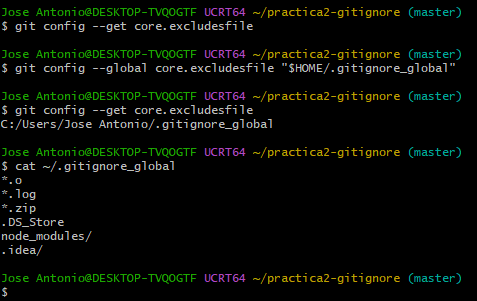
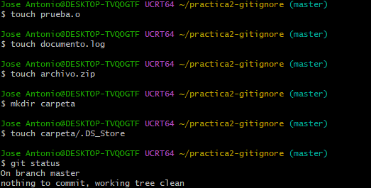
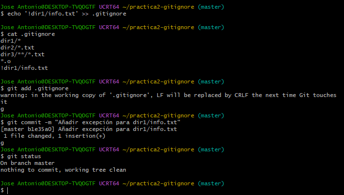

# Experimento con .gitignore y .gitignore_global
## 1. Configuración de .gitignore_global
Primero configuré el archivo `.gitignore_global` para ignorar algunos tipos de archivos de forma general en Git.
Los patrones que añadí fueron:
```text
*.o
*.log
*.zip
.DS_Store
node_modules/
.idea/
```
Para comprobar que Git estaba utilizando correctamente este archivo ejecuté:
```bash
git config --get core.excludesfile
```
El resultado mostró la ruta:
```text
C:/Users/Jose Antonio/.gitignore_global
```
Después comprobé el contenido del archivo y confirmé que todo se habia guardado correctamente.
### Captura de la configuración global

---
## 2. Prueba de .gitignore_global
Para comprobar el funcionamiento del archivo global creé varios archivos de prueba:
- `prueba.o`
- `documento.log`
- `archivo.zip`
- `carpeta/.DS_Store`
Después ejecuté:
```bash
git status
```
Ninguno de estos archivos apareció como pendiente de añadir, por lo que las reglas de `.gitignore_global` estaban funcionando correctamente.
### Captura de la prueba global

---
## 3. Configuración de .gitignore local
Después creé un archivo `.gitignore` dentro del repositorio.
Las reglas utilizadas fueron:
```text
dir1/*
dir2/*.txt
dir3/**/*.txt
*.o
!dir1/info.txt
```
Funciones de cada regla:
- `dir1/*` ignora los archivos que hay dentro de `dir1`.
- `!dir1/info.txt` hace que `info.txt` no sea ignorado.
- `dir2/*.txt` ignora los archivos `.txt` de `dir2`.
- `dir3/**/*.txt` ignora los `.txt` de `dir3` y de las subcarpetas.
- `*.o` ignora los archivos `.o`.
### Captura del .gitignore local

---
## 4. Prueba de .gitignore local
Para comprobar estas reglas creé diferentes carpetas y archivos.
En `dir1` creé:
```text
info.txt
notas.txt
programa.py
```
En `dir2` creé:
```text
test.txt
otros.py
```
Y en `dir3`:
```text
test1.txt
subdir/test2.txt
```
Después ejecuté:
```bash
git status
```
Git muestra `dir1` y `dir2` como carpetas con archivos disponibles para añadir.
Esto pasa porque `dir1/info.txt` se permite por la regla con `!` y `dir2/otros.py` tampoco está ignorado, pero los archivos `.txt` en las reglas no aparecen.
### Captura del funcionamiento del .gitignore local

---
## 5. Uso del operador !
El operador `!` hace una excepción dentro de una regla de `.gitignore`.
Primero se ignora el contenido de `dir1`:
```text
dir1/*
```
Después se permite el archivo `info.txt`:
```text
!dir1/info.txt
```
De esta forma el resto de archivos de `dir1` se ignoran, pero `info.txt` sí puede añadirse al repositorio.
---
## 6. Diferencia entre .gitignore_global y .gitignore
El archivo `.gitignore_global` afecta a todos los repositorios Git del usuario, es muy útil para ignorar archivos que normalmente no queremos subir en ningún proyecto, como archivos `.log`, `.zip` o archivos generados por programas.
Por otro lado, el archivo `.gitignore` local solo afecta al repositorio donde se encuentra, que en este caso lo he utilizado para crear reglas específicas para las carpetas `dir1`, `dir2` y `dir3`.
Con las pruebas he podido comprobar que ambos archivos pueden utilizarse al mismo tiempo y que Git aplica sus reglas al realizar `git status`.